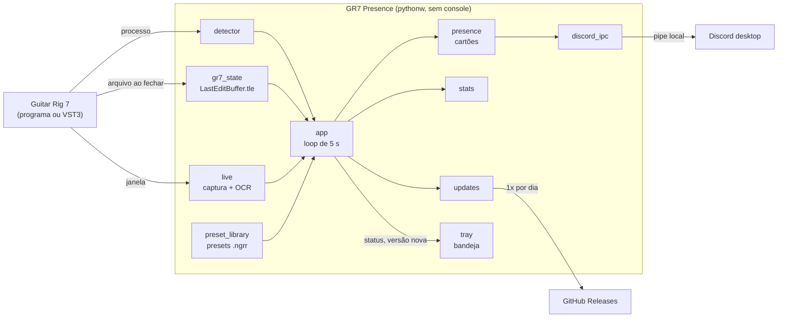
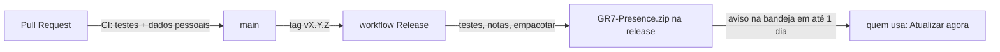

# Arquitetura

Como as peças do GR7 Presence conversam. As regras e as armadilhas estão no [`AGENTS.md`](../AGENTS.md);
o porquê de cada escolha, em [`decisoes.md`](decisoes.md).

## Visão geral

## O passo do loop

A cada 5 segundos, o `app.tick()`:

1. Recarrega o `config.json` se ele mudou, e dispara a consulta de versão nova se já passou um dia
   (em outra thread, para não segurar o loop).
2. Pergunta ao `detector` se o Guitar Rig está aberto: como programa (`Guitar Rig 7.exe`) ou como VST3
   carregado numa DAW conhecida. Mudou o processo? Fecha a sessão de estatísticas e abre outra.
3. Descobre o estado atual (`_current_state`):
   - o `LastEditBuffer.tle`, que vale para a abertura (o Guitar Rig reabre como fechou);
   - a captura da janela lida pelo OCR, que dá o nome do preset na tela e se o rack está vazio;
   - o nome lido é casado com a biblioteca de presets, e o `.ngrr` encontrado dá o amp, a cadeia e as
     tags;
   - os arquivos de áudio abertos pelo processo dão a faixa do Tape Deck.
4. Soma o tempo nas estatísticas (`dados\stats.json`, salvo a cada minuto e no fim da sessão).
5. Monta os cartões (`presence.build_cards`) e envia o da vez ao Discord. Os cartões se revezam a
   cada `rotate_seconds`. Quando o preset muda, o primeiro cartão vai na hora.

## Threads

| Thread | O que roda | Por quê |
|---|---|---|
| Principal | `tkinter` oculto, janela de estatísticas | O tkinter exige a thread principal |
| pystray | Ícone e menu da bandeja (`run_detached`) | Tem o próprio laço de mensagens do Windows |
| `presence` | O loop do `app` | Captura, OCR e Discord não podem travar a interface |
| `updates` | Uma consulta ao GitHub, e termina | Rede lenta não pode atrasar o loop |
| `download` | Baixa e confere o zip depois do "Atualizar agora" | A janela continua respondendo durante o download |

## Atualização com um clique

1. A bandeja abre a `UpdateWindow` com as notas da release. Em "Atualizar agora", a thread `download`
   baixa o anexo `GR7-Presence.zip` (só de uma release deste repositório) e confere o sha256 informado
   pela API.
2. `updates.start_updater` copia o `tools/atualizar.py` da versão instalada para a pasta temporária e o
   inicia, separado, com o PID do programa. O programa fecha como no "Sair" (salva as estatísticas e limpa
   o Discord).
3. O atualizador espera o PID sumir, confere o zip, guarda os arquivos que vai trocar em
   `dados\atualizacao\anterior`, extrai por cima e roda `tools\instalar.ps1 -Atualizacao`, que instala as
   dependências, gera o ícone e abre o programa.
4. Falhou qualquer passo: devolve os arquivos guardados, apaga os que a versão nova criou e reabre a
   versão anterior. O resultado vai para `dados\atualizacao.json`, e a bandeja avisa na próxima abertura.

As threads conversam pela fila do `TrayUI`, lida com `root.after` a cada 250 ms. Nenhuma outra
thread mexe em widget do tkinter.

## Arquivos de dados

Tudo em `dados\`, dentro da pasta do programa (ver a decisão D3):

| Arquivo | Conteúdo |
|---|---|
| `config.json` | Opções (README › Configuração); recarregado ao salvar |
| `stats.json` | Sessões de prática; um arquivo ilegível é guardado como `stats.corrompido-<horário>.json` |
| `live_state.json` | Último preset lido na tela, para sobreviver a um reinício com o Guitar Rig minimizado |
| `gr7_presence.log` | Log rotativo (512 KB, 3 arquivos) |
| `atualizacao.log` | Passo a passo de cada atualização, com a saída do instalador |
| `atualizacao.json` | Resultado da última atualização; a bandeja avisa e apaga |
| `atualizacao\anterior\` | Os arquivos trocados na última atualização, para o caminho de volta |
| `palavras-privadas.txt` | Só para quem publica versões: a lista que o `empacotar.py` procura |

## Formatos do Guitar Rig

- **`LastEditBuffer.tle`** (`%LOCALAPPDATA%\Native Instruments\Guitar Rig 7`): blocos
  `atad <versão> <tipo invertido> bilz <tamanho comprimido> <tamanho original> <zlib>`, com três XMLs:
  `<soundinfo>` (nome, autor, tags), `<gr-instrument-chunk>` (o rack) e `<user_state>` (caminho do
  último preset).
- **`.ngrr`** (presets de fábrica em `Common Files\Native Instruments\Guitar Rig 7\Rack Presets` e do
  usuário em `Documentos\Native Instruments\User Content\Guitar Rig 7\Rack Presets`): árvore binária de
  blocos `hsin`/`DSIN` com os mesmos XMLs sem compressão. O programa só precisa dos XMLs.

`tests/sinteticos.py` gera os dois formatos com dados inventados, e é a melhor referência executável.

## Distribuição

O zip leva só arquivos versionados, sem os testes e sem as ferramentas de publicação. O instalador
gera o ícone a partir do Guitar Rig da própria máquina.
